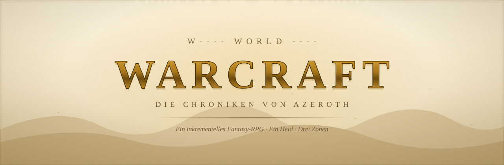
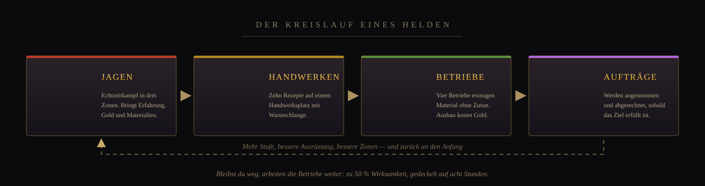
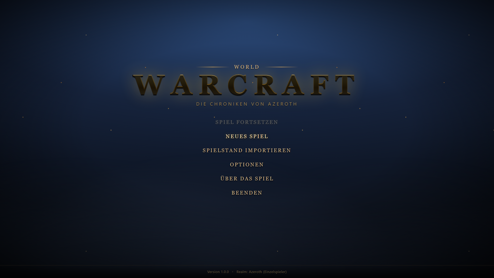
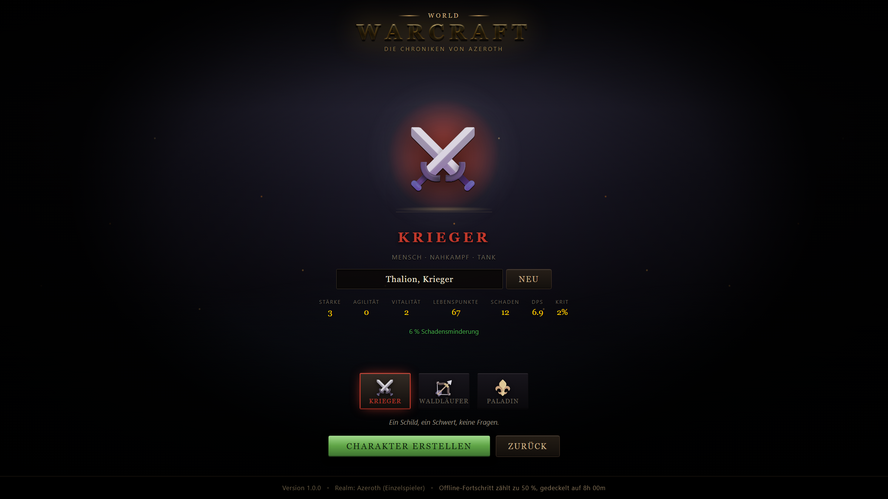
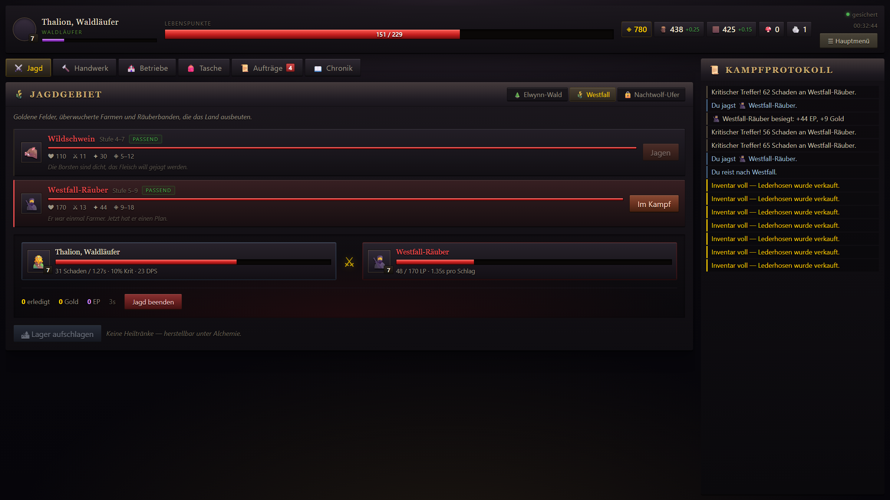
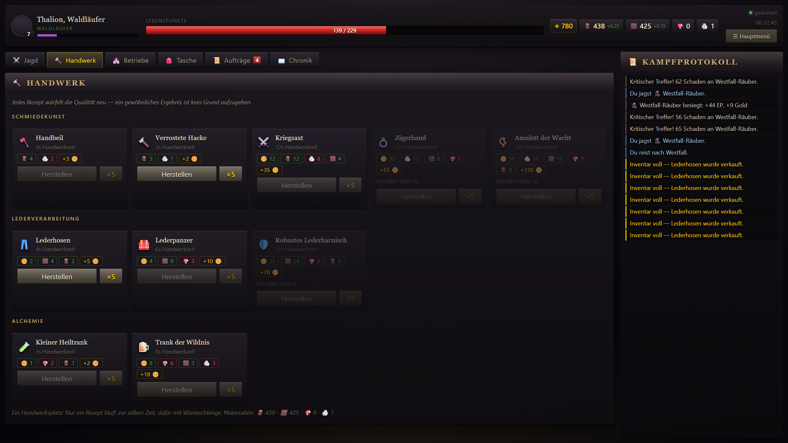
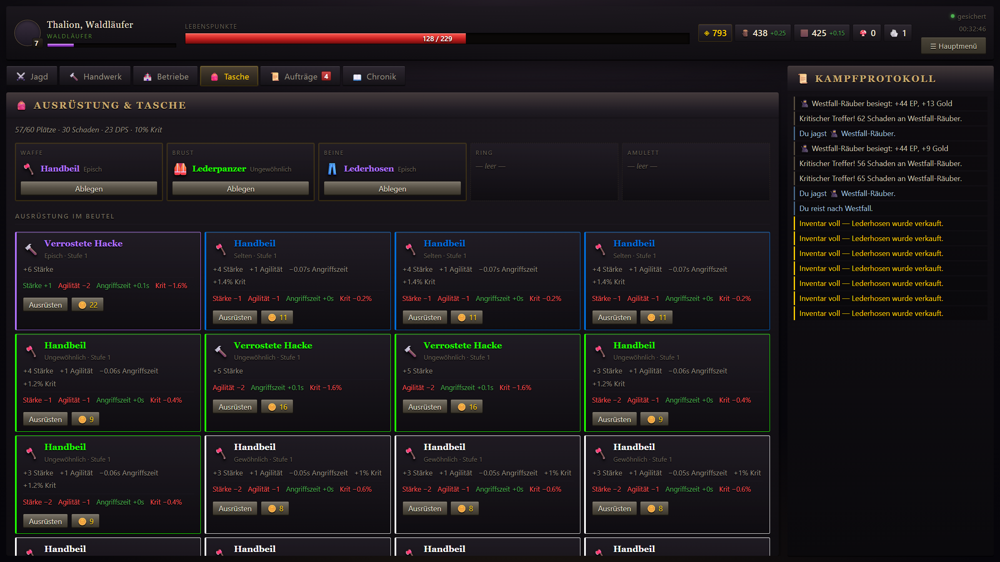
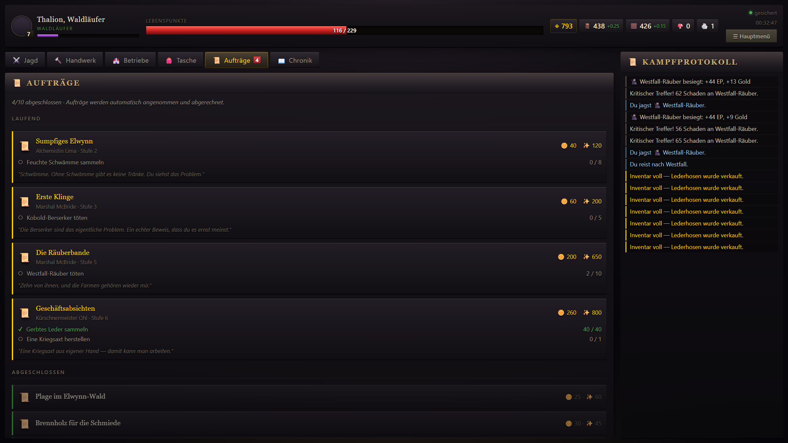

<p align="center">
  <picture>
    <source media="(prefers-color-scheme: dark)" srcset="docs/header-dark.svg">
    <source media="(prefers-color-scheme: light)" srcset="docs/header-light.svg">
    
  </picture>
</p>

<p align="center">
  <a href="https://trobikus.github.io/Die-Chroniken-von-Azeroth/"><b>▶ Jetzt im Browser spielen</b></a>
  &nbsp;·&nbsp;
  <a href="#loslegen">Lokal starten</a>
  &nbsp;·&nbsp;
  <a href="#screenshots">Screenshots</a>
</p>

<p align="center">
  
  
  
  
  
  
</p>

---

Ein inkrementelles Fantasy-RPG im Stil von World of Warcraft — **für einen einzelnen Helden, im
Browser, ohne Server und ohne Account.** Du jägst, sammelst und handwerkst, während deine Betriebe im
Hintergrund weiterarbeiten. Auch dann, wenn du die Seite längst geschlossen hast.



## Loslegen

**Im Browser** — nichts installieren, einfach
[die veröffentlichte Version öffnen](https://trobikus.github.io/Die-Chroniken-von-Azeroth/).
Der Spielstand liegt im `localStorage` des Browsers.

**Lokal** — für Entwicklung und zum Ändern:

```bash
git clone https://github.com/Trobikus/Die-Chroniken-von-Azeroth.git
cd Die-Chroniken-von-Azeroth
npm install
npm run dev
```

Dann auf <http://localhost:5173/> öffnen.

## Klassen

Die Wahl ist endgültig und prägt den ganzen Verlauf. Werte beziehen sich auf Stufe 1 ohne Ausrüstung.

<table>
  <thead>
    <tr><th>Klasse</th><th>Schaden</th><th>Angriffszeit</th><th>Lebenspunkte</th><th>Krit</th><th>Dauerhafter Vorteil</th></tr>
  </thead>
  <tbody>
    <tr>
      <td><b>Krieger</b><br>Ein Schild, ein Schwert, keine Fragen.</td>
      <td align="right"><b>12,1</b></td><td align="right">1,75 s</td><td align="right">67</td><td align="right">2,0 %</td>
      <td>6 % weniger erlittener Schaden</td>
    </tr>
    <tr>
      <td><b>Waldläufer</b><br>Ein Pfeil. Sehr schnell.</td>
      <td align="right">8,0</td><td align="right"><b>1,58 s</b></td><td align="right">62</td><td align="right"><b>6,5 %</b></td>
      <td>+4 % Krit-Chance, schnellste Folge</td>
    </tr>
    <tr>
      <td><b>Paladin</b><br>Das Licht schließt die Wunden.</td>
      <td align="right">8,0</td><td align="right">1,60 s</td><td align="right"><b>72</b></td><td align="right">3,1 %</td>
      <td>+1,2 % Regeneration pro Sekunde</td>
    </tr>
  </tbody>
</table>

## Screenshots

<table>
  <tr>
    <td width="50%"></td>
    <td width="50%"></td>
  </tr>
  <tr>
    <td align="center">Hauptmenü</td>
    <td align="center">Charaktererstellung</td>
  </tr>
  <tr>
    <td width="50%"></td>
    <td width="50%"></td>
  </tr>
  <tr>
    <td align="center">Jagdgebiet im Kampf</td>
    <td align="center">Handwerk</td>
  </tr>
  <tr>
    <td width="50%"></td>
    <td width="50%"></td>
  </tr>
  <tr>
    <td align="center">Tasche</td>
    <td align="center">Aufträge</td>
  </tr>
</table>

## Umfang

| | |
|---|---|
| Zonen | Elwynn-Wald, Westfall, Nachtwolf-Ufer |
| Gegner | 6, darunter der Alpha-Nachtwolf als Elite-Boss |
| Rezepte | 10 in drei Berufen, auf einem Handwerksplatz |
| Betriebe | 4 mit exponentiellen Ausbaukosten |
| Aufträge | 10, automatisch angenommen und abgerechnet |
| Klassen | 3 |
| Stufen | bis 20 |

## Aufbau

```
src/
  game/          Spiellogik ohne React — deterministisch und im Node testbar
    data/        Items, Rezepte, Betriebe, Zonen, Aufträge, Level-Kurve
    engine.ts    Reducer: Kampf, Handwerk, Produktion, Aufträge
    selectors.ts berechnet Heldenwerte aus Stufe, Ausrüstung und Klasse
    save.ts      Serialisierung, Offline-Fortschritt, Import/Export
  components/    Panels der Ingame-Ansicht
  screens/       Hauptmenü, Charaktererstellung, Optionen
  hooks/         React-Bindings
scripts/         Simulations-, Render- und Screenshot-Tests
docs/            Bilder für diese README
```

Die Spiellogik kennt React nicht. Deshalb lässt sich derselbe Code im Browser **und** in einem
Node-Prozess gegen echte Spielstände laufen lassen — das nutzen die Testläufe. Der Zufall läuft über
einen seedbaren PRNG, der im Spielstand liegt: ein Spielverlauf ist exakt reproduzierbar.

## Drei Fehler, die die Tests gefunden haben

Beim Bauen der Prüfstände fielen drei Dinge auf, die im manuellen Spielen kaum aufgefallen wären:

- **Handwerken lief in beliebig vielen Werkbänken gleichzeitig.** Damit war die Zeitökonomie wertlos —
  die Warteschlange hat keinen Sinn, wenn man sieben Stücke parallel starten kann.
- **Außerhalb des Kampfes gab es keine Heilung.** Ein verletzter Held kam nicht mehr hoch und hing
  fest, bis genug Heiltränke gesammelt waren.
- **Speicherfehler wurden kommentarlos geschluckt.** Im privaten Fenster oder bei vollem Speicher
  ließ sich nichts ablegen — der Spieler hätte stundenlang gespielt, ohne es zu bemerken, und
  wäre beim Schließen der Seite um alles gekommen.

## Spielstand

`npm run saves` prüft dreizehn Angriffsszenarien: Rundlauf, defekter, manipulierter und
abgeschnittener Spielstand, voller Speicher, blockierter Speicher, alte Formatversion,
zurückgestellte Uhr, Export und Import.

Dagegen abgesichert:

- **Drei identische Ablagen** statt einer, jede mit Prüfsumme. Ein halb geschriebener Wert kostet
  nicht mehr den ganzen Helden.
- **Fehler werden sichtbar.** Schlägt das Sichern fehl, steht ein roter Hinweis im Bild und die
  Kopfzeile sagt „Nicht gesichert" — mit der Ursache, ob nun der Speicher voll ist oder der
  Browser das Schreiben blockiert.
- **Beim Schließen wird immer gesichert**, auch mit ausgeschaltetem Autospiel.
- **Export als Datei**, weil sich Browserdaten wegräumen lassen, eine heruntergeladene Datei nicht.

Was das System nicht kann: Es gibt keine Cloud. Wer den Zwischenspeicher leert, ist auf den
Export angewiesen — deshalb ist die Sicherungskopie in der Chronik so auffällig platziert.

## Skripte

MIT — siehe [LICENSE](LICENSE).

Fan-Projekt zu World of Warcraft. Es verwendet keine Originalgrafiken, -Texte oder -Audio von
Blizzard Entertainment. World of Warcraft ist eine eingetragene Marke von Blizzard Entertainment.
Dieses Projekt steht in keiner Verbindung zu Blizzard.
